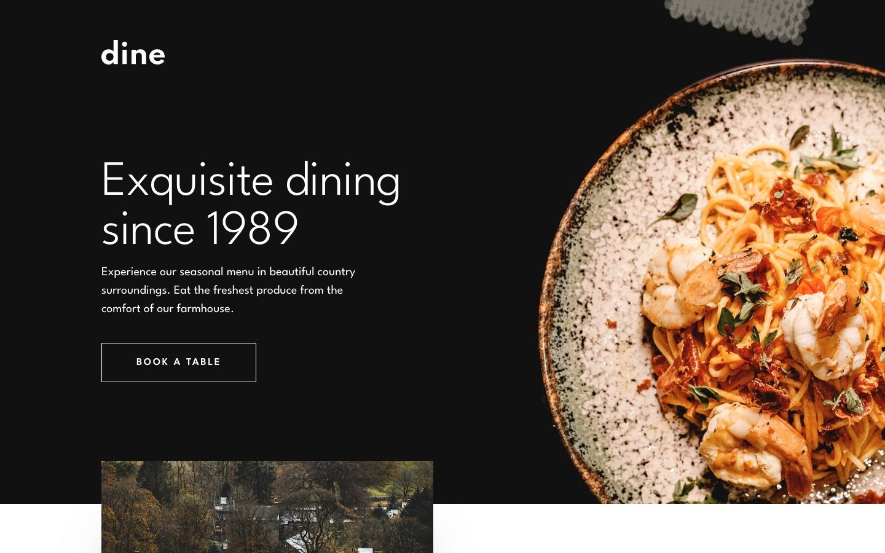

# Frontend Mentor - Dine restaurant website solution

This is a solution to the [Dine restaurant website challenge on Frontend Mentor](https://www.frontendmentor.io/challenges/dine-restaurant-website-yAt7Vvxt7). I built a restaurant home page with event tabs and a booking page that validates a demo reservation.

## Table of contents

- [Overview](#overview)
  - [The challenge](#the-challenge)
  - [Screenshot](#screenshot)
  - [Links](#links)
- [My process](#my-process)
  - [Built with](#built-with)
  - [What I learned](#what-i-learned)
  - [Continued development](#continued-development)
- [Run it locally](#run-it-locally)
- [Author](#author)

## Overview

### The challenge

Users should be able to:

- View the home and booking pages on mobile, tablet and desktop screens.
- See hover and keyboard focus states for interactive controls.
- Switch between Family Gathering, Special Events and Social Events using the mouse or keyboard.
- Follow a Book a table link to the booking page.
- Enter a name, email, date and time, choose AM or PM, and adjust the party size.
- Receive validation messages for missing or invalid booking details.
- See a demo confirmation after submitting valid details.

### Screenshot



### Links

- Solution URL: [My Frontend Mentor solution](https://www.frontendmentor.io/solutions/dine-restaurant-with-nextjs-typescript-and-tailwind-pT1cWUqINW)
- Live Site URL: [Dine restaurant website](https://dine-restaurant.royeradames.com)

## My process

### Built with

- Next.js 16 App Router
- React 19
- TypeScript
- Tailwind CSS 4, Flexbox and CSS Grid
- TanStack Form
- Zod validation
- League Spartan through `next/font/google`
- Responsive images with `<picture>` and `srcset`
- Playwright for browser tests

### What I learned

I made the event tabs work with mouse clicks, arrow keys, Home and End. The selected tab also receives focus. Without JavaScript, the server-rendered Family Gathering panel stays readable, but switching events needs JavaScript.

The October 8 sweep found the booking form spilling past its card at 320 px. I kept error messages in the form's flow and added room around them. I linked each message to its input with `aria-describedby` and moved focus to the first invalid field after a failed submit.

I learned to check booking dates against the restaurant's clock. I use `Intl.DateTimeFormat` with `Europe/London` so a visitor's time zone does not change what counts as today. I also check real calendar dates and reject a time that has already passed today.

### Continued development

- Event switching still needs JavaScript. The fallback only shows Family Gathering.
- The booking form only validates details in the browser. It has no reservation service behind it.

## Run it locally

Use Node.js 22.13.0 or newer.

```sh
npm install
npm run dev        # http://localhost:3000
npm run lint
npm run typecheck
npm run build
npm test           # build first; Playwright starts `next start` on port 4411
SCREENS=1 npx playwright test screens   # review screenshots in ./screenshots
```

The Playwright commands need an existing production build. I keep visible text at 16 px or more, including the footer and validation messages, which differs from the supplied design's smaller text.

The booking form is a demo. It checks details in the browser. Nothing is sent and no table is reserved. Booking needs JavaScript.

The booking rules are:

- Name is required.
- Email is required and must be a valid address.
- Month, day and year are required, must form a real calendar date, and cannot be before today.
- Hour must be 1 to 12 and minute 0 to 59. Both are required. A booking for today must be later than the current time.
- Today and now use `Europe/London`. Bookings go up to a year ahead.
- Party size is 1 to 20 people.

## Author

- Website - [Royer Adames](https://royeradames.com)
- Frontend Mentor - [@royeradames](https://www.frontendmentor.io/profile/royeradames)
